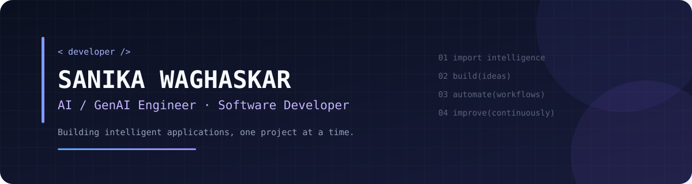

  

  <h2>Hi, I'm Sanika Waghaskar 👋</h2>

  

    <strong>Aspiring AI/GenAI Engineer · Software Developer</strong>
  

  

    Computer Engineering student at VIIT, Pune, passionate about
    building intelligent applications, AI-powered developer tools,
    and practical software solutions.
  

  
  

---

## 💫 About Me

- 🎓 Final-year Computer Engineering student specializing in Software Engineering.
- 🤖 Interested in Generative AI, LLM-powered applications, and intelligent automation.
- 🛠️ Building projects that combine AI capabilities with practical software engineering.
- 🌱 Currently strengthening my GenAI, backend development, and system design fundamentals.
- 🎯 Career goal: AI/GenAI Engineer or Software Developer.

## 🚀 Featured Projects

### 🤖 AI Tester Agent

AI-assisted software testing that connects requirements, test generation, browser automation, and execution reporting.

**Tech:** React · FastAPI · Playwright · LLMs · PostgreSQL

- Generate test cases from software requirements.
- Automate browser-based test execution.
- Capture failures and present execution results.

[View Repository](https://github.com/Pratikshadokhe/AI-Tester-Agent)

### 📄 Healthcare Secure — Document Parser

A document-processing component for extracting and preprocessing insurance information for an AI-powered healthcare assistant.

**Tech:** Python · PDF Processing · NLP · LLMs

- Extract text from PDF documents.
- Preprocess information for downstream processing.
- Validate extracted information against the source document.

[View Repository](https://github.com/LaboneeyDhanure/Healthcare_Secure_Industry_Project)

## 🧰 Tech Stack

  <h4>Languages</h4>

  
  
  
  

  <h4>Frontend & Backend</h4>

  
  
  
  

  <h4>AI, Automation & Tools</h4>

  
  
  
  
  

## 📊 GitHub Activity

  

  

## 🌱 Currently Learning

- Generative AI and LLM application development
- Retrieval-Augmented Generation (RAG) fundamentals
- Backend engineering and API design
- Software testing, evaluation, and reliability

## 🤝 Let's Connect

  
  
  

  
<i>Learning continuously. Building thoughtfully. Improving every day.</i>

